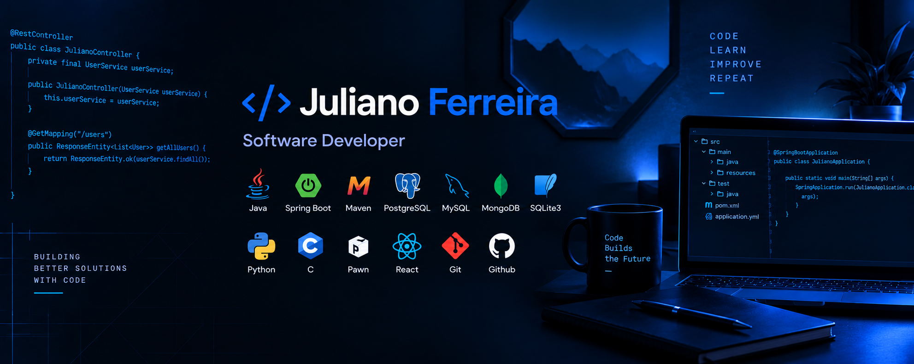

# Juliano Ferreira [@MrBlue2041]

**Desenvolvedor de Software | Java · Spring Boot · React**

Desenvolvimento backend, APIs REST, modelagem de dados e arquitetura de software.

## 🛠️ Tecnologias e ferramentas

  

  

  

## 🚀 Projetos em destaque

### [BarberHub](https://github.com/MrBlue2041/BarberHub)

Plataforma SaaS multi-tenant para gerenciamento de barbearias.

- APIs REST desenvolvidas com Java e Spring Boot
- Gerenciamento de contas e barbearias
- Persistência de dados com PostgreSQL
- Arquitetura multi-tenant em desenvolvimento

**Status:** Em desenvolvimento.

### [WebServices](https://github.com/MrBlue2041/web-services)

Projeto voltado ao desenvolvimento de serviços web e APIs, explorando comunicação entre aplicações e organização do backend.

### [WorkShop-Mongo](https://github.com/MrBlue2041/WorkShop-Mongo)

Projeto prático com foco em MongoDB, persistência de dados e bancos de dados NoSQL.

### [PimPontePreta](https://github.com/MrBlue2041/PimPontePreta)

Aplicação digital voltada à experiência de torcedores da Ponte Preta, com funcionalidades relacionadas a cadastro, ingressos e sócio-torcedor.

### [Bender-Web](https://github.com/wlldavid/bender-web)

Projeto colaborativo de desenvolvimento web utilizando React, com foco na construção de interfaces e componentes reutilizáveis.

**Contribuição:** Desenvolvimento frontend com React.

## 💡 Áreas de interesse

- Desenvolvimento backend
- APIs REST e integração entre sistemas
- Modelagem e persistência de dados
- Arquitetura de software
- Desenvolvimento de aplicações web

---

  <i>Desenvolvendo soluções. Resolvendo problemas. Evoluindo continuamente.</i>

